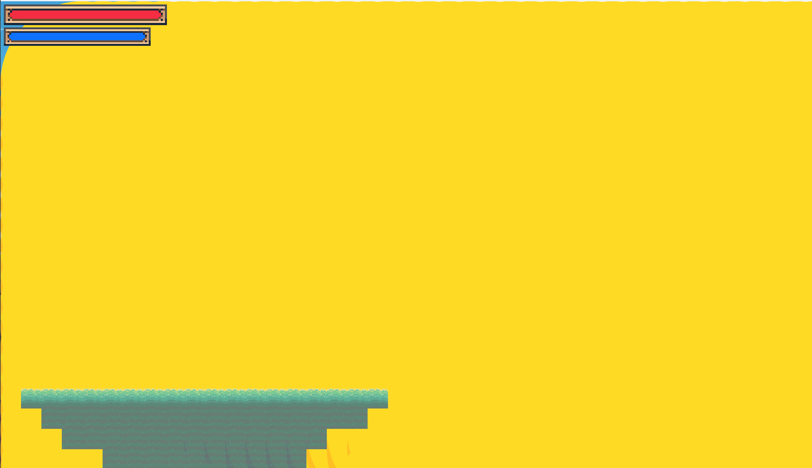

# Some tiles in TileMap cannot find their textures [CLOSED]


## Description
 
Some tiles in TileMap cannot find their textures
 
## Logs
 
```
Object - Error: the file is not open or not found
AnimObject - Error: the file is not open or not found
MovingObject - Error: the file is not open or not found
MovingAnimObject - Error: the file is not open or not found
forSwitch - Error: the file is not open or not found
Chest - Error: the file is not open or not found
```
 
## Screenshot
 
