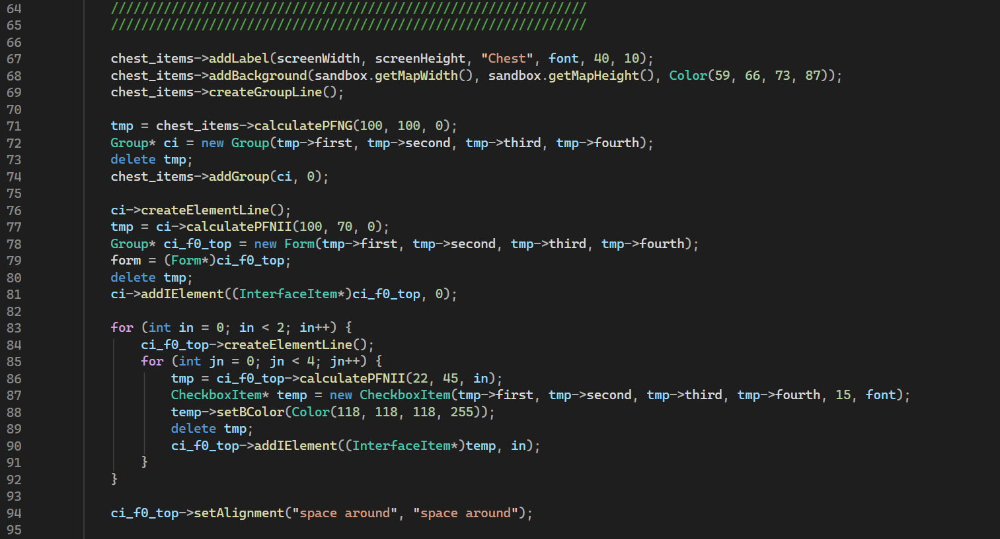

# UI System Refactoring and Improvement

## Description
 
Currently, the UI in the project is built manually inside constructors (for example, `Level::Level`). A single constructor contains ~150 lines of interface-building code: `PopUpWindow`, `Group`, `Form`, `CheckboxItem`, `ScaleParameterBar`, etc. This is hard to read, maintain, and extend.

## Problems with the Current Implementation

- **Imperative interface construction.** Sizes, positions, colors, and texts are hardcoded in C++ code. Any visual change requires rebuilding the project.
- **Cumbersome layout.** Constant calls to `calculatePFNG` / `calculatePFNII` with percentage parameters followed by `delete tmp`; the need to keep track of row indices (`createElementLine`, `addIElement(..., 0)`).
- **Inconvenient callback handling.** Binding via `addCallback(getButtonState(i), BTN_ACTIVE, ...)` depends on button indices rather than meaningful identifiers.
- **String-based alignment settings.** `"center auto"`, `"space around"`, `"left 10"` are parsed at runtime and not checked by the compiler.
- **Mixing logic and UI.** The class constructor builds the interface while also initializing other entities.
- **Duplication.** The same patterns (button + callback, window + background + title) are copied across every screen.

## Goal

Make UI creation and management simple, declarative, and independent from game logic.

## Screenshot
 
